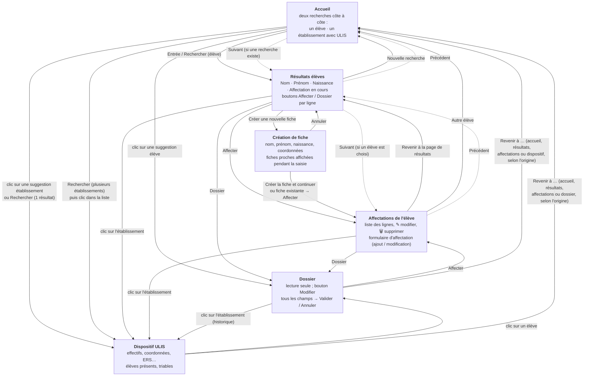

# Navigation du widget « Affectation »

Six pages, une seule visible à la fois. Les flèches pleines sont des boutons de la page ; les pointillés sont les boutons « Précédent / Suivant » du bandeau d'étapes (atteignables seulement si la recherche ou le choix d'élève existe).

Le bouton de retour de la page Dossier et de la page Dispositif porte le nom de la page d'où l'on vient : le schéma les résume par une seule flèche.

## Page Dispositif

- Informations : effectifs calculés (présents, liste d'attente, autres situations) et, quand elles existent dans `Etablissements_avec_ULIS`, les colonnes UAI, adresse, code postal, commune, téléphone, courriel, directeur, ERS, capacité, effectif saisi.
- Élèves présents : ceux dont la ligne de scolarité en cours (la plus récente dont la date est passée) désigne cet établissement, avec la situation « En ULIS » et hors liste d'attente. Un interrupteur ajoute la liste d'attente et les autres situations.
- Tri : élève (nom, prénom), classe (ordre des choix de `Niveau_saisi`), première notification, fin de droits ; un second clic inverse l'ordre ; une date absente reste toujours en dernier.

## Fenêtres (pop-ups)

| Où | Déclencheur | Fenêtre | Issue |
|---|---|---|---|
| Affectations | corbeille ou « Supprimer cette affectation » | Supprimer cette affectation ? | Oui : `RemoveRecord` · Non : rien |
| Affectations | « Enregistrer » une affectation modifiée | Enregistrer ces modifications ? (avant → après) | Oui : `UpdateRecord` · Revenir : formulaire conservé |
| Dossier | « Valider » | Enregistrer ces modifications ? (avant → après, avertissement si état civil) | Oui : un seul `UpdateRecord` sur `Individus` · Revenir : champs conservés |
| Dossier | quitter ou « Annuler » avec des champs modifiés | Abandonner les modifications en cours ? | Oui : changements perdus, la navigation continue · Non : on reste |

La nouvelle affectation (ajout) et la création de fiche s'enregistrent sans fenêtre. Fermer l'onglet avec une édition non validée déclenche aussi l'avertissement du navigateur (selon le contexte d'iframe de Grist).

## Sorties gardées de la page Dossier

Toutes les sorties passent par la même garde : retour (quelle que soit l'origine), « Affecter », clic sur un établissement de l'historique. Si l'édition est ouverte mais inchangée, on sort sans fenêtre.
