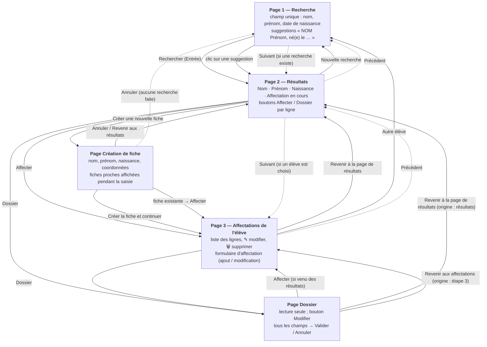

# Navigation du widget « Affectation »

Cinq pages, une seule visible à la fois. Les flèches pleines sont des boutons de la page ; les pointillés sont les boutons « Précédent / Suivant » du bandeau d'étapes (atteignables seulement si la recherche ou le choix d'élève existe).

## Fenêtres (pop-ups)

| Où | Déclencheur | Fenêtre | Issue |
|---|---|---|---|
| Page 3 | corbeille ou « Supprimer cette affectation » | Supprimer cette affectation ? | Oui : `RemoveRecord` · Non : rien |
| Page 3 | « Enregistrer » une affectation modifiée | Enregistrer ces modifications ? (avant → après) | Oui : `UpdateRecord` · Revenir : formulaire conservé |
| Page Dossier | « Valider » | Enregistrer ces modifications ? (avant → après, avertissement si état civil) | Oui : un seul `UpdateRecord` sur `Individus` · Revenir : champs conservés |
| Page Dossier | quitter ou « Annuler » avec des champs modifiés | Abandonner les modifications en cours ? | Oui : changements perdus, la navigation continue · Non : on reste |

La nouvelle affectation (ajout) et la création de fiche s'enregistrent sans fenêtre. Fermer l'onglet avec une édition non validée déclenche aussi l'avertissement du navigateur (selon le contexte d'iframe de Grist).

## Sorties gardées de la page Dossier

Toutes les sorties passent par la même garde : « Revenir à la page de résultats » (bandeau et pied de page), « Revenir aux affectations », « Affecter ». Si l'édition est ouverte mais inchangée, on sort sans fenêtre.
