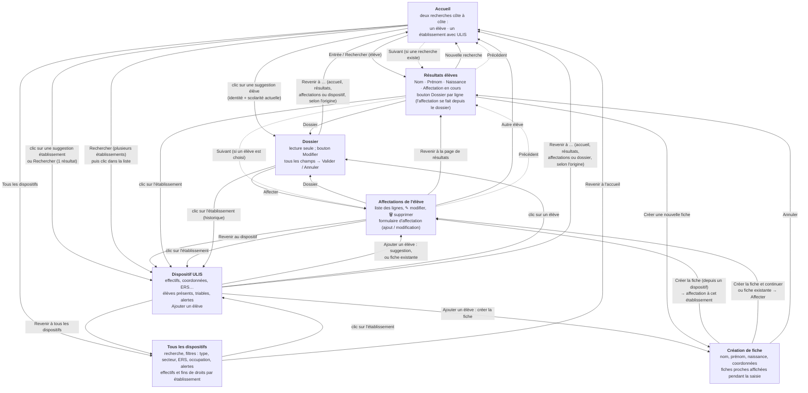

# Navigation du widget « Affectation »

Sept pages, une seule visible à la fois. Les flèches pleines sont des boutons de la page ; les pointillés sont les boutons « Précédent / Suivant » du bandeau d'étapes (atteignables seulement si la recherche ou le choix d'élève existe).

Le bouton de retour de la page Dossier et de la page Dispositif porte le nom de la page d'où l'on vient : le schéma les résume par une seule flèche.

## Page Dispositif

- Informations : effectifs calculés (présents sur `Places_max`, liste d'attente, autres situations) ; colonnes de `Etablissements_avec_ULIS` (UAI, commune, secteur ERS, ERSH, secteur et coordonnateur CDOEA, nombre de dispositifs, ouverture) ; coordonnées (adresse, code postal, téléphone, courriel, directeur) cherchées dans `Etablissements_ERS`, la table liée par `Uai`.
- Règle commune (formule `Actuellement_en_ULIS`) : dernière ligne de l'élève dont la date est passée, datée de l'année scolaire en cours (depuis le 1er septembre), situation « En ULIS » ou vide. Reprise telle quelle sans la colonne ; « Autres situations » ne retient que l'année scolaire en cours.
- Dossier et suggestions de recherche : la ligne « En cours » est celle que `Actuellement_en_ULIS` marque (la plus récente), sinon aucune ; sans cette colonne, la ligne datée la plus récente.
- Élèves présents : ceux que la colonne `Actuellement_en_ULIS` de Scolarite (formule Grist, la même que pour `Effectif`) marque pour cet établissement, hors liste d'attente. Sans cette colonne : ligne de scolarité en cours (la plus récente dont la date est passée), situation « En ULIS », hors liste d'attente. Deux bascules affichent aussi la liste d'attente et les autres situations.
- Tri : élève (nom, prénom), classe (ordre des choix de `Niveau_saisi`), première notification, fin de droits ; un second clic inverse l'ordre ; une date absente reste toujours en dernier.

- Ajouter un élève : bouton en tête de la liste ; recherche d'une fiche (suggestions, Entrée) ou création d'une nouvelle fiche. L'élève arrive à l'étape 3 avec le formulaire de nouvelle affectation déjà rempli avec l'établissement (niveaux limités à son type).
- Alertes : le panneau « Fins de droits à surveiller » compte les fins échues (rouge) et proches (orange, 120 jours, constante `FIN_DROITS_ALERTE_JOURS`), avec un bouton « Trier par fin de droits » ; chaque élève concerné porte une pastille avec texte (« Échue depuis 5 mois », « Fin dans 2 mois »), jamais la couleur seule.
- Dossiers incomplets : une pastille « Dossier incomplet » (avec la liste de ce qui manque en infobulle) apparaît quand le nom, le prénom ou la date de naissance manque ; elle est visible dans les résultats, le dispositif (avec un panneau de comptage) et en tête du dossier.

## Page Tous les dispositifs

Accessible depuis l'accueil. Tableau de tous les établissements avec ULIS : type, secteur, ERS, effectif présent sur places, liste d'attente et fins de droits (échues / proches). Filtres combinables : type (École, Collège, Lycée), secteur (`Secteur_CDOEA`), ERS (`Secteur_ERS`) et « Fins de droits » (échues ou proches). Le retour depuis un dispositif conserve les filtres.

## Fenêtres (pop-ups)

| Où | Déclencheur | Fenêtre | Issue |
|---|---|---|---|
| Affectations | corbeille ou « Supprimer cette affectation » | Supprimer cette affectation ? | Oui : `RemoveRecord` · Non : rien |
| Affectations | « Enregistrer » une affectation modifiée | Enregistrer ces modifications ? (avant → après) | Oui : `UpdateRecord` · Revenir : formulaire conservé |
| Dispositif | interrupteur « Liste d'attente » d'un élève | Mettre cet élève en liste d'attente ? / Retirer… | Oui : `UpdateRecord` de `Liste_d_attente` sur la ligne en cours · Non : rien |
| Dossier | « Valider » | Enregistrer ces modifications ? (avant → après, avertissement si état civil) | Oui : un seul `UpdateRecord` sur `Individus` · Revenir : champs conservés |
| Dossier | quitter ou « Annuler » avec des champs modifiés | Abandonner les modifications en cours ? | Oui : changements perdus, la navigation continue · Non : on reste |

La nouvelle affectation (ajout) et la création de fiche s'enregistrent sans fenêtre. Fermer l'onglet avec une édition non validée déclenche aussi l'avertissement du navigateur (selon le contexte d'iframe de Grist).

## Sorties gardées de la page Dossier

Toutes les sorties passent par la même garde : retour (quelle que soit l'origine), « Affecter », clic sur un établissement de l'historique. Si l'édition est ouverte mais inchangée, on sort sans fenêtre.

## Notes et boutons d'action du dossier

- Chaque note a, en fin de ligne, un crayon (modifier, avec confirmation avant → après) et une corbeille (confirmation, focus sur « Non, garder »). La suppression d'une note ne change pas de page : le dossier est rechargé.
- « Affecter » se trouve sous l'historique des affectations ; le bouton « retour » reste en bas du dossier.
- Le titre « ANESH » en haut de page ramène à l'accueil (garde de sortie incluse).
- Toute écriture dans Grist passe par une fenêtre de confirmation : récapitulatif pour un ajout, avant → après pour une modification, rappel de la ligne pour une suppression.
